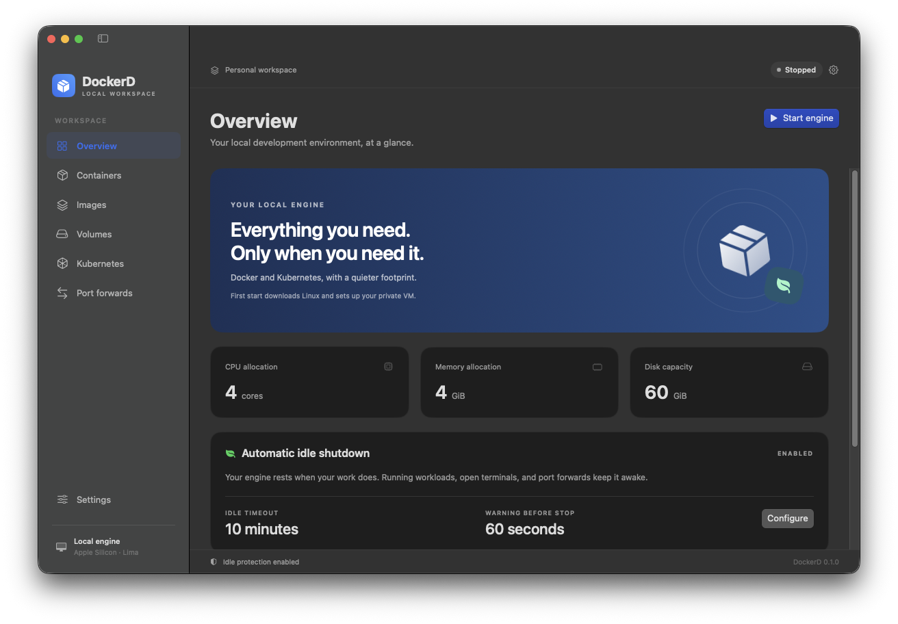

# DockerD

A native macOS desktop for Docker Engine and a local Kubernetes cluster, with configurable idle shutdown. Apple Silicon, macOS 14 or newer. Docker Desktop is not required.



## Build and open

Requires Xcode Command Line Tools, Swift 5.10+, Go 1.24+, Python 3.11.8+, and internet access for runtime downloads.

```sh
make test
make app
open dist/DockerD.app
```

`make app` downloads checksum-locked Lima, Docker CLI, Compose, Buildx, and kubectl binaries and packages a locally signed app. The first engine start downloads a roughly 590 MiB Linux image, verifies its checksum, provisions Docker and K3s, and creates the `dockerd-local` Docker context. Interrupted image downloads resume on retry.

Move the app to its permanent location before installing CLI links. Homebrew, Docker Desktop, and a separate Lima installation are not required. Local builds are ad-hoc signed; notarized distribution requires your Apple Developer ID.

## Everyday use

- **Overview:** engine controls, live VM usage, shutdown blockers, and countdown cancellation.
- **Logs:** live service, startup, VM, and boot-console logs with filtering and copy controls, available even when the service is disconnected.
- **Containers:** Compose grouping, lifecycle actions, logs, inspection, and interactive terminals in macOS Terminal.
- **Images:** pull, inspect, tag, run with an optional localhost port, and remove.
- **Volumes:** create, inspect, and remove persistent storage. Docker rejects deletion of volumes still in use.
- **Kubernetes:** namespace filtering, pod details, logs, terminals, and port forwards.
- **Settings:** resources, shared folders, Kubernetes, idle timing, appearance, notifications, login startup, and CLI integration.

Closing the window leaves the menu-bar controller and background service active. Explicit Quit lets you stop the engine or leave it running with idle monitoring. Opening DockerD does not automatically start the engine.

## What “idle” means

The default is **10 continuous idle minutes**, followed by a **60-second cancelable countdown**. Running/paused user containers, pending/running/terminating pods, open exec/attach sessions, pod port forwards, and engine mutations/transfers prevent shutdown. Always-running applications keep the engine awake even without CPU or network traffic.

Only identified app-installed Kubernetes infrastructure is exempt. External Docker and kubectl sessions through the provided endpoints are tracked, including silent open connections. Kubernetes audit reconciliation also detects pod sessions through the internal endpoint. Missing or stale observations prevent automatic shutdown; ambiguous audit history requires a restart to establish a trustworthy baseline.

Shutdown gracefully stops Kubernetes, Docker, and the VM while preserving images, volumes, and cluster state. Wake is explicit through the app or menu bar. CLI requests while stopped fail promptly without waking the VM.

## CLI access

**Settings → Install CLI links** adds tools under `~/.local/bin` and Compose/Buildx under `~/.docker/cli-plugins`. Existing tools are never overwritten. Add this to your shell configuration:

```sh
export PATH="$HOME/.local/bin:$PATH"
docker --context dockerd-local ps
export KUBECONFIG="$HOME/Library/Application Support/DockerD/kubeconfig"
kubectl get pods -A
```

Your active Docker context is preserved unless you explicitly switch it in Settings. Kubernetes configuration stays separate from `~/.kube/config`. Use the CLI or Compose for builds, environment variables, bind mounts, and advanced container options. Add bind-mount project directories to Shared folders while the engine is stopped.

## Development and validation

```sh
make test       # Go race tests, go vet, Swift transport tests
make backend    # Local Go service
make app        # Complete native application
```

For end-to-end validation, run the service with a **dedicated** `--home` directory, then:

```sh
python3 scripts/integration-test.py --home /absolute/path/to/test-state
```

The suite creates temporary workloads, exercises ports and sessions, changes idle timing, actually stops/restarts the VM, and verifies volume persistence. Do not target an environment with work you need to keep running. One DockerD Kubernetes VM can use the fixed local ports at a time.

See [architecture](docs/architecture.md), [operations and troubleshooting](docs/operations.md), [validation results](docs/validation.md), and [third-party notices](docs/third-party.md). Generated binaries, VM data, logs, downloads, and credentials are excluded from Git.

## Initial release boundaries

One local VM/cluster on Apple Silicon, macOS 14+. This is an independent app with core local workflows, not full Docker Desktop feature parity. Extensions, cloud integrations, Intel builds, migration, automatic runtime upgrades, and automatic wake are not included. Disk capacity is fixed after VM creation. Runtime versions are updated through a rebuilt app.
